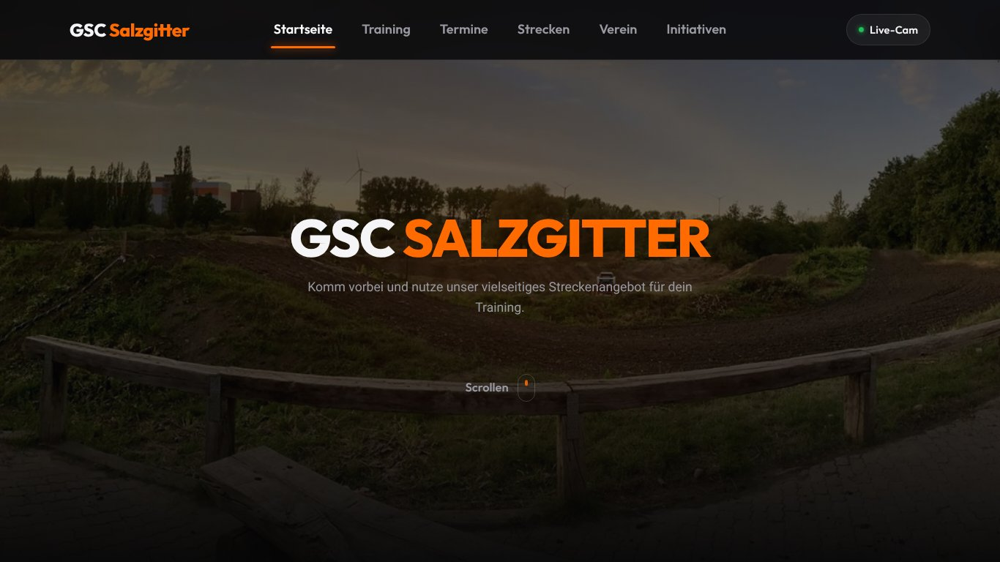
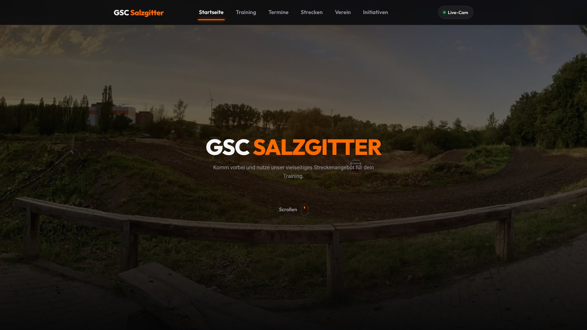
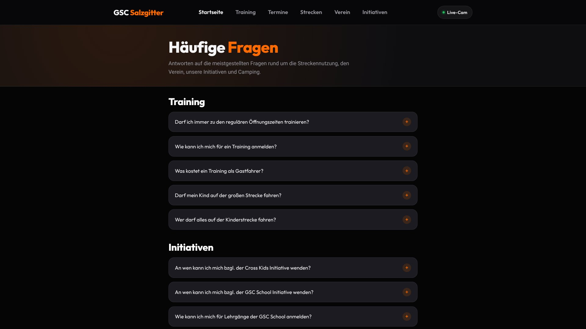

# Arbeitsregeln & Änderungsprotokoll eingeführt

- **Datum:** 2026-11-17
- **Branch:** `claude/gifted-tesla-myq3dq`
- **Status:** Wartet auf Freigabe

## Was wurde geändert?

Es wurde ein fester Ablauf für künftige Änderungen an der Website festgelegt:

- **`CLAUDE.md`** (neu): Regeln für die Arbeit am Repository. Änderungen werden zuerst
  in einem eigenen Branch committet. Zu jeder Änderung gibt es ein Protokoll mit
  Beschreibung und Screenshots. Erst nach Freigabe durch den Nutzer wird nach `main`
  übernommen, und erst dann geht die Änderung live.
- **`aenderungsprotokoll/`** (neu): Übersicht aller Änderungen (`README.md`) und
  Vorlage für neue Einträge (`VORLAGE.md`).
- **`scripts/screenshots.mjs`** (neu): erstellt automatisch Screenshots der gebauten
  Website für iPhone 17, Laptop (1366 × 768) und Desktop (1920 × 1080).

Am Inhalt und Aussehen der Website selbst wurde **nichts** verändert.

## Warum?

Jeder Push auf `main` wird sofort auf www.gsc-salzgitter.de veröffentlicht. Durch den
neuen Ablauf kann jede Änderung vorher anhand von Screenshots geprüft und bewusst
freigegeben werden.

## Betroffene Seiten und Dateien

- Webseiten: keine (nur Dokumentation und Hilfsskript)
- Dateien: `CLAUDE.md`, `aenderungsprotokoll/*`, `scripts/screenshots.mjs`

## Screenshots (Funktionstest des Screenshot-Skripts)

Die Aufnahmen zeigen den aktuellen, unveränderten Stand und belegen, dass das Skript funktioniert.

### Startseite `/`

| iPhone 17 | Laptop | Desktop |
|-----------|--------|---------|
|  |  |  |

Ganze Seite: [iPhone 17](screenshots/start-iphone17-ganzeseite.jpg) ·
[Laptop](screenshots/start-laptop-ganzeseite.jpg) ·
[Desktop](screenshots/start-desktop-ganzeseite.jpg)

### FAQ `/faq`

| iPhone 17 | Laptop | Desktop |
|-----------|--------|---------|
|  |  |  |

Ganze Seite: [iPhone 17](screenshots/faq-iphone17-ganzeseite.jpg) ·
[Laptop](screenshots/faq-laptop-ganzeseite.jpg) ·
[Desktop](screenshots/faq-desktop-ganzeseite.jpg)

## Prüfhinweise für die Qualitätsprüfung

- Die iPhone-17-Aufnahmen werden mit dem Playwright-Geräteprofil „iPhone 17“
  (402 px Breite, 3-fache Pixeldichte) erstellt. Steht WebKit (die Safari-Engine)
  zur Verfügung, wird es genutzt, sonst Chromium. In dieser Umgebung lief Chromium.
  Kleine Unterschiede zu echtem Safari, etwa bei Schriftglättung, sind möglich.
- Nebenbefund (nicht Teil dieser Änderung): Auf der FAQ-Seite ist in der Navigation
  „Startseite“ als aktiv markiert.

## Freigabe

- [ ] Vom Nutzer freigegeben am: …
- [ ] In `main` übernommen am: …
